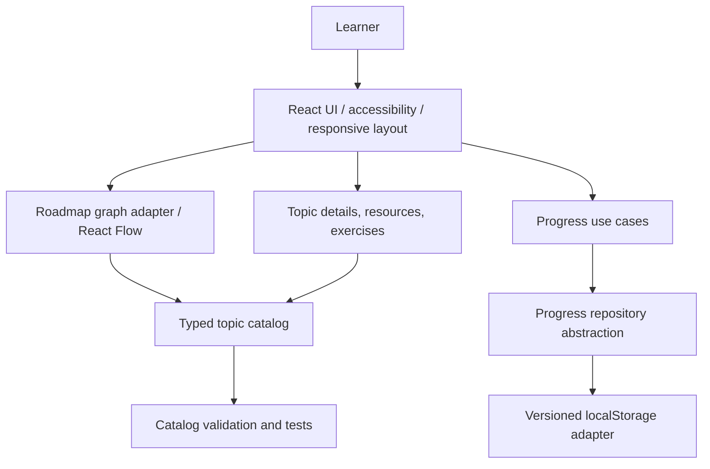
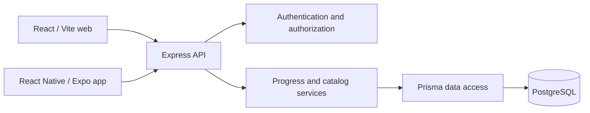

# Full-Stack Mastery Roadmap

> **Product purpose, architecture, and implementation plan**<br>
> **Project:** `Laurenceonly/Full-Stack-Mastery-Roadmap`<br>
> **Version:** Planning baseline 1.0 · October 23, 2026<br>
> **Status:** V1 foundation developed; V2a catalog and V2b interface implemented locally; V2c and later phases planned<br>
> **Document location in repository:** `ARCHITECTURE_AND_PROJECT_PLAN.md`

> **Implementation update (2026-10-23):** The typed catalog and validation are implemented locally, including HTML, CSS, JavaScript, and optional Tailwind CSS. All nine V1 IDs remain. See [RESUME.md](RESUME.md) for checks and next steps and [KNOWLEDGE.md](KNOWLEDGE.md) for the project overview. Later sections retain the original planning baseline; they do not imply later milestones are complete.

## Current user requirements (2026-10-23)

The user supplied a dark neon dashboard reference and requested compact subject grouping, consistent alignment/spacing, technology and tool logos, multiple resources per topic, and verified free online certificates. Prerequisites must not appear in the topic panel. Dependency metadata remains in the domain and alternate graph. These explicit requests supersede earlier presentation suggestions below. See PRODUCT.md and KNOWLEDGE.md for the implemented product and RESUME.md for the actual checkpoint.

## 1. Executive summary

Full-Stack Mastery Roadmap is a responsive, interactive, roadmap-style learning application for becoming an independent full-stack software engineer. It offers an ordered, dependency-aware journey from product planning and web fundamentals to TypeScript, React, Next.js, backend APIs, PostgreSQL, mobile apps, testing, deployment, and maintenance. Unlike a static roadmap, users can explore learning objectives, find credible resources, practice skills, and track demonstrable mastery.

**Core principle:** This application is *both* a useful product and a hands-on engineering portfolio project. Its development lifecycle should demonstrate the very practices it teaches: requirements, architectural decisions, version control, implementation, testing, security, documentation, delivery, and ongoing maintenance.

**North-star outcome:** A learner can answer “What should I learn next, why does it come next, how can I practice it, and how do I know I've mastered it?” without being overwhelmed by a tool list.

## 2. Problem, goals, and boundaries

### 2.1 Problem

- Generic developer roadmaps show topics but often lack clear prerequisites, measurable outcomes, actionable practice, and individually tracked progress.
- Course and certification claims can go stale; learners need source links and honest distinctions between a *free course* and a *free certificate*.
- A large graph can overwhelm users on mobile and become hard to maintain if every topic is hardcoded into JSX.

### 2.2 Primary user and experience

The primary user is a learner building professional TypeScript-based web, backend, database, and cross-platform mobile skills. The initial application can remain single-user and client-side; multi-device sync and multiple accounts are later capabilities.

### 2.3 Product goals

1. Present a **clear primary TypeScript full-stack path** with optional branches.
2. Represent **prerequisite relationships** explicitly, without suggesting that everything must be mastered in one rigid order.
3. Attach **learning outcomes, tasks, projects, and vetted resources** to each topic.
4. Preserve progress reliably and display completion at topic and phase levels.
5. Work on desktop, tablet, and mobile, including accessible keyboard interaction.
6. Remain deployable at low/no cost for early stages, without misleading guarantees about provider free tiers.
7. Grow incrementally through tested, reviewable Pull Requests.

### 2.4 Non-goals for V2

- Building a production multi-tenant LMS.
- Hosting video courses or issuing accredited certificates.
- Using AI to automatically declare a skill mastered.
- Replacing official documentation with copied course content.
- Introducing authentication or a database before a clear multi-device/user need exists.

## 3. Product scope and learning journey

### 3.1 Core learning stages

| Stage | Core competencies | Representative tools |
|---|---|---|
| 0. Engineering workflow | Problem definition, requirements, user stories, wireframes, Git, GitHub Flow, accessibility basics | Markdown, Figma, Git, GitHub Projects |
| 1. Web foundations | Semantic HTML, CSS, responsive UI, browser/devtools, JavaScript, HTTP | Browser DevTools, VS Code |
| 2. TypeScript foundations | Types, unions, interfaces, generics, modules, async, runtime validation | TypeScript, Zod |
| 3. Frontend engineering | React components/hooks, routing, forms, state, accessibility, React framework concepts | React, Vite, Tailwind, shadcn/ui, Next.js |
| 4. Backend engineering | Node runtime, Express, REST, validation, structured errors, configuration, auth principles | Node.js, Express, Bruno |
| 5. Data and persistence | SQL, PostgreSQL modeling, constraints, migrations, transactions, indexes, ORM tradeoffs | PostgreSQL, Prisma, DBeaver |
| 6. Full-stack integration | API contracts, session/auth, permissions, uploads, security, observability | Zod, HTTP clients, OWASP references |
| 7. Testing and quality | Unit, integration, E2E, accessibility, CI, code reviews | ESLint, Vitest, Testing Library, Playwright |
| 8. Mobile engineering | React Native patterns, Expo, navigation, native capabilities, API reuse | React Native, Expo |
| 9. Delivery and operations | Environment management, containers, workflows, hosting, DB backups, monitoring | Docker, GitHub Actions, Vercel, managed services |
| 10. Professional mastery | Architecture tradeoffs, performance, documentation, portfolio, maintenance | ADRs, Lighthouse, production metrics |

**Parallel learning tracks:** Security, accessibility, testing, Git collaboration, and documentation should recur across stages instead of appearing only at the end.

### 3.2 Learning-unit requirements

Every topic node should have:

- Unique stable ID and human-readable title.
- Stage/category; short description and learning objective.
- Prerequisite topic IDs; optional/required flag; difficulty.
- Resource records with provider, URL, type, cost, certification status, and last verification date.
- At least one practice task and evidence/acceptance criteria for completion.
- Estimated effort as an optional range, **not** a promise.

### 3.3 Example capstone progression

1. Static responsive profile page: HTML/CSS/accessibility.
2. TypeScript app with browser persistence: TS, state, error handling.
3. React CRUD dashboard: components, forms, routing, testing.
4. Node/Express API: REST, validation, logging, tests.
5. PERN application: PostgreSQL, migrations, authorization, deployment.
6. Expo companion app: shared API contracts, mobile navigation, auth.
7. Production-readiness exercise: CI, monitoring, backup and recovery drills, documentation.

## 4. Current baseline and target phases

### 4.1 V1 — implemented foundation (reported locally)

- React + TypeScript + Vite application using Tailwind CSS and `@xyflow/react`.
- Nine broad nodes, prerequisite connections, detail sidebar, resource links, local `localStorage` completion state.
- ESLint and `tsc -b && vite build` run successfully; browser UI displayed.
- Foundation Pull Request #1 merged into `main` according to project workflow.

**Verification boundary:** The above reflects reported development and checks, not an independent audit of the repository. Before major refactors, inspect the actual files and current Git branch.

### 4.2 Release phases

| Phase | Deliverable | Exit condition |
|---|---|---|
| V2a — Data foundation | Normalized typed catalog, schema validation, coherent topic IDs, content conventions | Every dependency points to an existing topic; no duplicate IDs; tests pass |
| V2b — Learner experience | Stage-based browsing, searchable/filterable nodes, details, legend, mobile-friendly navigation | Keyboard/mobile usability and key flows manually tested |
| V2c — Mastery tracking | 4-level progress model, phase stats, reset/export/import, safe versioned migration from V1 | Refresh preserves progress; migration preserves completed nodes |
| V2d — Learning content | Detailed node inventory, free resources, practice tasks, verification metadata | Each core topic has objectives, exercises and at least one trustworthy resource |
| V2e — Quality and deployment | CI, unit/component/E2E tests, accessible UI review, public preview | CI checks pass; deployed preview matches local build |
| V3 — Full-stack services, only if needed | Express API, PostgreSQL/Prisma, accounts, cross-device synchronization | Documented need, threat model, migrations, auth, API tests |
| V4 — Advanced learner features | Assessment evidence, portfolio milestones, adaptive suggestions | Learner research validates usefulness and complexity |

## 5. Architecture: current app and future evolution

### 5.1 Architectural principle

Use a **modular frontend with data-driven presentation** for V2. Keep roadmap content, progress logic, graph layout, and React components separate. Do not introduce a backend just because the learning curriculum covers backend technologies.

### 5.2 V2 logical design



**Boundaries:**
- **Catalog/data:** canonical topics and resources. No JSX and no direct browser storage.
- **Domain/types:** topic contracts, status types, validation and dependency traversal.
- **Graph adapter:** transforms catalog nodes and prerequisite edges into React Flow representations.
- **Progress:** computes learning status and derived summaries; persistence behind a small interface.
- **UI:** layout, graph, sidebar, navigation, keyboard interaction, and feedback.

### 5.3 Proposed repository layout

```text
Full-Stack-Mastery-Roadmap/
├── docs/
│   ├── ARCHITECTURE_AND_PROJECT_PLAN.md
│   ├── ADR-001-client-first.md                  # later
│   └── CONTRIBUTING.md                         # later
├── public/
├── src/
│   ├── app/                                      # app shell and providers
│   ├── components/
│   │   ├── layout/
│   │   ├── roadmap/
│   │   └── ui/
│   ├── data/
│   │   ├── topics/                              # grouped topic datasets
│   │   └── resources/
│   ├── domain/
│   │   ├── roadmap.ts                           # pure graph/domain logic
│   │   └── progress.ts
│   ├── features/
│   │   ├── roadmap/
│   │   └── progress/
│   ├── hooks/
│   ├── lib/
│   │   ├── catalog-validation.ts
│   │   └── storage/
│   ├── types/
│   │   └── roadmap.ts
│   ├── App.tsx
│   ├── main.tsx
│   └── index.css
├── .github/workflows/ci.yml                    # V2e
├── package.json
└── vite.config.ts
```

**Incremental migration:** Existing `src/data/roadmap.ts`, `src/types/roadmap.ts`, and `src/App.tsx` should evolve gradually; do not delete working components simply to match this diagram.

### 5.4 Data model proposal

```ts
export type LearningStatus =
  | 'not-started'
  | 'learning'
  | 'practicing'
  | 'completed';

export type ResourceKind = 'docs' | 'course' | 'video' | 'article' | 'exercise';
export type CertificateStatus = 'none' | 'free' | 'paid' | 'unknown';

export interface LearningResource {
  id: string;
  title: string;
  provider: string;
  url: string;
  kind: ResourceKind;
  freeToAccess: boolean | null;
  certificateStatus: CertificateStatus;
  verifiedAt?: string; // YYYY-MM-DD; omit if not yet verified
}

export interface RoadmapTopic {
  id: string;
  title: string;
  stageId: string;
  category: string;
  summary: string;
  objectives: string[];
  prerequisiteIds: string[];
  optional: boolean;
  estimatedHours?: { min: number; max: number };
  practiceTasks: string[];
  resourceIds: string[];
}

export interface ProgressRecord {
  topicId: string;
  status: LearningStatus;
  updatedAt: string; // ISO 8601
  evidenceUrls?: string[];
  notes?: string;
}

export interface SavedProgressV2 {
  schemaVersion: 2;
  records: Record<string, ProgressRecord>;
}
```

**Important:** The model above is *proposed*, not currently implemented. IDs must remain stable across versions so saved progress survives content edits. Keep content and progress records separately so UI presentation can change without losing user data.

### 5.5 Graph behavior

- Each topic renders once, with an `id` that matches the canonical catalog.
- An edge goes from prerequisite to dependent topic.
- Validate missing dependency IDs, duplicate IDs, self-dependency and circular dependencies.
- Stages are a browsing aid; prerequisite links may cross stages.
- Allow pan, zoom, fit view, selectable nodes, and a simple list mode for small screens and accessibility.
- Avoid hardcoding absolute XY positions for the complete curriculum. Start with stage/group layout and consider auto-layout only if complexity justifies a new dependency.
- Clarify optional vs required topics visually and textually, not through color alone.

### 5.6 Progress behavior and migration

- Status progression is **not-started → learning → practicing → completed**, with ability to move backward.
- V1 stored `Record<string, boolean>` under `roadmap-progress`. V2 must read this legacy representation and convert `true` to `completed`, `false`/missing to `not-started`.
- Write V2 to a *new* versioned key (e.g., `roadmap-progress-v2`) only after validating migration; preserve old data through at least one release.
- Treat localStorage as best-effort device-local storage; it can be cleared and is **not** cross-device sync.
- Offer JSON export/import with strict validation and clear warnings on overwrite.
- Compute progress denominators consistently: required topics only by default, optional topics separately; document this UI choice.

### 5.7 Future V3 backend (conditional)



Suggested backend modules: authentication, catalog, progress, assessments, and users. Maintain server-side validation, per-user authorization for records, migrations and database backup strategy. Do not store secrets in the client. Evaluate managed auth/services rather than inventing custom password handling. The V3 decision must explicitly compare building an Express server with using a managed backend and justify operational cost.

## 6. UX, accessibility, and design direction

**Style:** Minimalist, professional dark-first aesthetic, with strong typography, restrained accents, and spacious detail panels. Keep design tokens centralized rather than adding one-off colors in JSX.

**Desktop:** Header with progress overview; large graph canvas; details panel; filter/search toolbar. **Tablet:** collapsible details and balanced graph. **Mobile:** stage list as a first-class alternative to a dense canvas; bottom sheet or full-screen topic detail; touch-friendly controls.

**Accessibility:** Clear heading hierarchy, visible focus indicators, keyboard-selectable topics, accessible button names, adequate contrast, non-color-only status indicators, reduced-motion consideration, and screen-reader-friendly alternative to the node graph. Treat the graph as an enhancement, not the only route to content.

**Primary learner journey:** Open app → choose stage or search topic → inspect prerequisites/outcomes → access trusted resource → perform practice task → update status → see next suggested topic.

## 7. Functional requirements and acceptance criteria

| ID | Requirement (“The system shall…”) | Acceptance criteria |
|---|---|---|
| FR-01 | Render roadmap topics and prerequisite connections from the canonical catalog | Every defined core topic appears with valid edges; no orphan dependency |
| FR-02 | Show description, objectives, tasks, and resources for a selected topic | Topic detail can be opened by mouse and keyboard |
| FR-03 | Search and filter by stage, category and status | Matching results update predictably; empty state appears |
| FR-04 | Update a topic's learning status | Status changes update counts immediately |
| FR-05 | Persist progress between refreshes | Progress survives reload in the same browser, with migration tests |
| FR-06 | Distinguish optional topics from required topics | Label appears in list and detail; denominator behavior is explained |
| FR-07 | Provide accessible non-graph browsing | All topics and actions remain reachable without drag/zoom gestures |
| FR-08 | Identify course accessibility and certification status transparently | No course is labeled “free certificate” without verification source/date |
| FR-09 | Permit export and import of progress JSON | Invalid schema rejected with a helpful message; valid data restored |
| FR-10 | Build and pass checks before release | Lint, type/build, tests and CI green |

### 7.1 Nonfunctional requirements

- **Reliability:** No application crash on malformed stored progress; show safe defaults and retain recoverable data.
- **Performance:** Lazy-load heavy views when needed, monitor main bundle size, and avoid rendering all details at once.
- **Security:** Treat imported JSON as untrusted; use safe link attributes; never expose server secrets or store tokens casually.
- **Maintainability:** Pure validated domain functions; small components; typed data contracts; documented decisions.
- **Portability:** Development works through documented npm scripts on supported Node LTS versions.
- **Privacy:** V2 progress lives locally; inform users of that limitation before promising synchronization.

## 8. Learning-content editorial standard

Every recommended resource should include its provider, original URL, resource type, whether learning content is free, whether proof of completion/certification is free, and **date verified**. A free course is not necessarily a free certificate. Until independently verified, mark certification status as `unknown`. Prefer original publisher documentation and official course pages. Review dead links and changing access conditions periodically.

Topic creation checklist:

1. Stable topic ID, stage, category, one-paragraph summary.
2. Two or three measurable learning objectives.
3. Explicit prerequisites that exist in the catalog.
4. At least one hands-on task and measurable completion evidence.
5. At least one maintained high-quality learning resource.
6. Honest cost/certificate labeling, with verification date if asserted.
7. Data validation and UI check.

## 9. Engineering workflow and quality gates

### 9.1 GitHub Flow

1. Keep `main` stable and releasable.
2. Open a focused `feat/`, `fix/`, `docs/`, or `refactor/` branch from up-to-date `main`.
3. Make small, explained changes; test locally.
4. Commit with a meaningful Conventional Commit message.
5. Push and create a PR describing scope, screenshots, tests, and known limitations.
6. Review diffs; require CI when configured; squash merge; sync local `main`.

**Important for this learning project:** Each CLI command must be explained *before* the learner is asked to execute it: what it does, each flag, why it is appropriate, and expected outcome. Avoid commands that install unrelated tooling.

### 9.2 Testing pyramid

- **Domain/unit:** Catalog validation; prerequisites; progress calculations; V1→V2 migration; import/export validation.
- **Component:** Topic detail, status control, search, empty states, keyboard interactions.
- **End-to-end:** Open node, mark in progress, refresh, filter, view resource, export/import.
- **Manual smoke tests:** Mobile viewport, tablet layout, keyboard-only flow, reduced motion, broken link fallback.

Recommended stack at the appropriate phase: ESLint, TypeScript build, Vitest, Testing Library, Playwright, GitHub Actions. Install tests when the corresponding work begins, not all at once unnecessarily.

### 9.3 Continuous integration

On PRs to `main`, CI should install with reproducible lockfile, run lint, run type/build, and run tests once implemented. Use least-privilege workflow permissions and cache responsibly. Deployment previews are a follow-up, not required to build V2a.

## 10. Deployment and operations

**V2:** Static Vite build is compatible with static hosting (such as Vercel). Confirm routing fallback and environment configuration if client-side routes are added. Use Git-based preview deployments after checks are reliable.

**V3:** Choose backend/database hosting only once synchronization is needed. Compare free-tier constraints, sleep behavior, resource limits, pricing changes, database backup limits, and availability. Prefer a documented design decision over relying on a supposedly permanent free provider.

Operational checklist: build verification, secrets handling, HTTPS, dependency updates, basic error telemetry where appropriate, release notes, data export/backup guidance, recovery instructions.

## 11. Security and privacy

- V2: No account creation; do not collect sensitive personal information unnecessarily.
- All user-provided import content must be schema-validated and size-limited.
- Links should have safe protocols and `rel="noopener noreferrer"` when using `target="_blank"`.
- Do not render user-entered notes as unsanitized HTML.
- When adding V3, define authentication flow, authorization model, rate limiting, audit sensitivity, CORS policy, CSRF/session decisions, and data retention before release.

## 12. Delivery backlog and recommended order

### Milestone A — Foundation cleanup (small PR)

- [ ] Inspect current merged `main`, verify clean status, review existing components and imports.
- [ ] Create/commit this planning document under `docs/`.
- [ ] Create ADR for client-first persistence.
- [ ] Record current smoke-test steps and screenshots.

### Milestone B — Typed catalog (V2a)

- [ ] Introduce typed topics/resources and named stages.
- [ ] Convert nine umbrella nodes without changing their IDs unnecessarily.
- [ ] Add catalog validation for duplicates, missing dependencies and cycles.
- [ ] Unit-test validation and deterministic progress calculations.
- [ ] Keep V1 interactive UI functional during migration.

### Milestone C — Usability (V2b)

- [ ] Add topic search and stage/category filters.
- [ ] Improve node statuses, legend, viewport controls and detail clarity.
- [ ] Implement accessible topic list for keyboard/mobile.
- [ ] Add responsive sidebar/bottom-sheet design.

### Milestone D — Progress (V2c)

- [ ] Four status levels with meaningful progress summary.
- [ ] Migrate `roadmap-progress` boolean data safely.
- [ ] Add import/export and predictable reset flow.
- [ ] Test persistence across reloads, corrupt data and schema versions.

### Milestone E — Curriculum (V2d)

- [ ] Split each umbrella stage into small learning topics.
- [ ] Specify objective, prerequisites, practice and evidence for each topic.
- [ ] Add resources and clearly verified certification metadata.
- [ ] Add skill projects that bridge stages.

### Milestone F — Quality/release (V2e)

- [ ] Configure GitHub Actions checks.
- [ ] Add component and E2E tests for critical flows.
- [ ] Run keyboard/mobile/accessibility review.
- [ ] Publish preview and document deployment process.

**PR sizing:** Prefer one coherent milestone subset per PR rather than combining data migration, UI redesign, testing setup, and backend services into one risky change.

## 13. Risks and mitigations

| Risk | Impact | Mitigation |
|---|---|---|
| Large roadmap graph becomes unreadable | High | Stage-based views, filters, list fallback, optional collapse |
| Existing users lose local progress | High | Stable topic IDs, migration tests, versioned storage and export |
| Broken or misleading course/certificate claims | Medium–high | Editorial verification metadata; unknown until verified |
| Premature backend complexity | Medium | Stay client-first until sync/account needs are validated |
| Hardcoded JSX and layout positions | Medium | Canonical data + graph adapter + layout conventions |
| Scope creep from adding every ecosystem tool | High | Primary path vs optional branches; milestone acceptance criteria |
| Weak mobile/keyboard usability | High | Design list mode and keyboard behavior early |
| Free hosting limits or price changes | Medium | Document tradeoffs, avoid permanence promises, enable portability |

## 14. Architectural decisions to record

| ID | Proposed decision | Reason | Revisit when |
|---|---|---|---|
| ADR-001 | Client-first architecture for V2 | Faster learning/product iteration; lower operational burden | Multi-device sync or accounts are required |
| ADR-002 | Stable IDs + normalized catalog | Keeps graph/content/test logic maintainable | Content editing becomes collaborative |
| ADR-003 | Versioned local progress | Protects existing V1 progress | Backend sync is introduced |
| ADR-004 | React Flow plus accessible list view | Graph is engaging but not sufficient on small screens | UX studies suggest a better navigation pattern |
| ADR-005 | TypeScript as primary language | Matches the target engineering learning path | Strong evidence of another specialized need |

## 15. Definition of done

A feature is done only when:

- [ ] It fulfills documented requirements and acceptance criteria.
- [ ] Existing V1 user flows still work.
- [ ] Lint, TypeScript build and relevant tests pass.
- [ ] Critical flows work at representative desktop and mobile widths.
- [ ] Keyboard/accessible alternatives exist for essential interactions.
- [ ] New data has stable IDs and content validation.
- [ ] Progress handling preserves or explicitly migrates stored data.
- [ ] Any claim about resource cost or certification is verified or marked unknown.
- [ ] The PR describes changes, test evidence, risks and screenshots if UI changed.
- [ ] Documentation is updated and merged through normal GitHub Flow.

## 16. Immediate next action

**Recommended next small PR:** `docs/product-architecture-plan` containing this document and a short README link to it. Then start `feat/detailed-roadmap` (V2a) with **typed catalog + validation only**. Do not mix a major UI rewrite into the schema migration. Verify actual branch state before creating a new branch, especially if `feat/detailed-roadmap` has already been created.

### Success measures for V2

- Learner can identify their next appropriate topic in under a minute during a usability test.
- Every required topic has valid dependencies, objectives, practice, and a working resource.
- Progress survives page refresh and migration from V1.
- The entire experience remains usable without a mouse or diagram gestures.
- Automated checks reject invalid catalog references and failing builds.

---

*Planning artifact. This is a living document: revise through Pull Requests as engineering discoveries or learner feedback change the design.*
