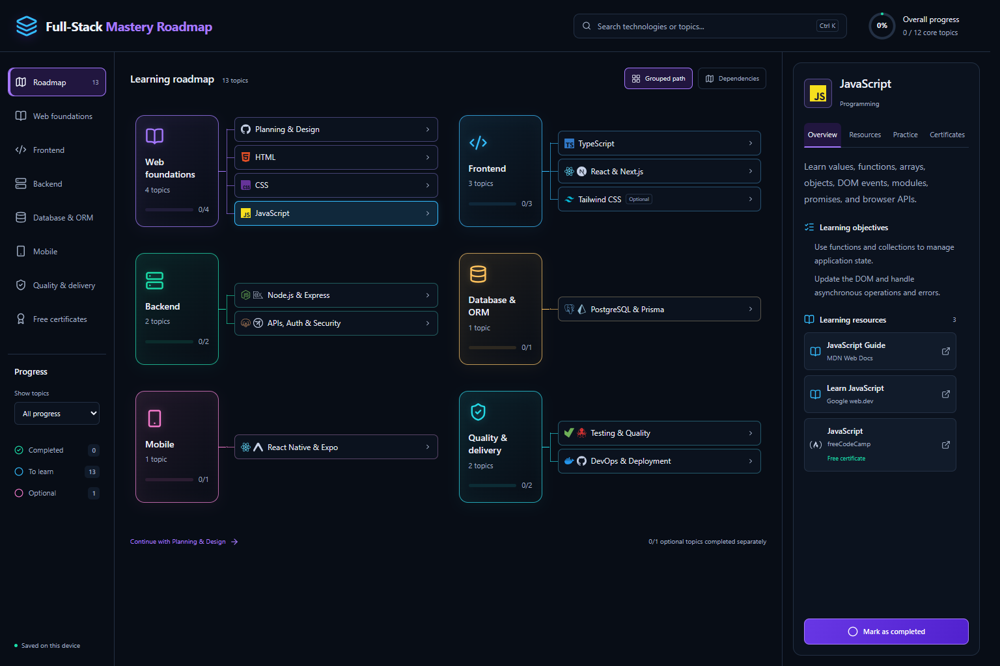
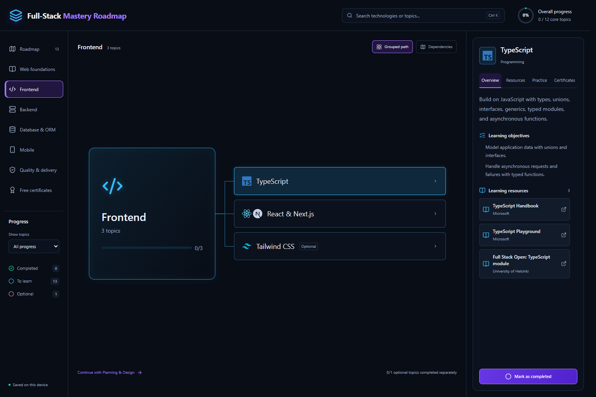

# Full-Stack Mastery Roadmap

An interactive learning roadmap for developing full-stack engineering skills, from HTML, CSS, and JavaScript to TypeScript, frontend frameworks, backend APIs, databases, mobile apps, testing, and deployment.

Explore related skills, choose learning resources, complete hands-on practice, and track progress in your browser.

## Features

- **Six subject groups:** Web foundations, Frontend, Backend, Database & ORM, Mobile, and Quality & delivery.
- **13 learning topics:** 12 core topics and optional Tailwind CSS, with stable IDs that preserve existing completion records.
- **Focused subject pages:** Larger cards, topic rows, text, and logos centered in the learning canvas. The full overview stays compact.
- **Topic guides:** Overview, Resources, Practice, and Certificates sections with objectives and completion criteria.
- **Multiple learning resources:** At least two choices per topic, with 38 normalized resources overall.
- **Free certificate options:** Seven verified courses from freeCodeCamp, University of Helsinki, and Harvard CS50, with provider evidence, dates, and completion requirements.
- **Search and filters:** Find topics, browse subjects, filter completion, and search the certificate catalog. Ctrl/Cmd K focuses search.
- **Local progress:** Completion survives reload, required and optional totals are separate, and storage failures show feedback.
- **Responsive dark interface:** Local technology/tool logos, inline topic guides on smaller screens, keyboard focus indicators, and stable alignment when scrollbars appear.
- **Dependency view:** An alternate interactive graph with pan, zoom, and fit controls. Prerequisites are omitted from the topic guide.

## Getting started

Use **Node.js 24 LTS** and npm. Run these commands from the repository root:

| Command | Purpose and expected result |
| --- | --- |
| `npm ci` | Install the exact dependencies from `package-lock.json`. |
| `npm run dev` | Start Vite and print the local development URL. |
| `npm test` | Run the automated catalog, graph, progress, grouping, certificate-metadata, and logo checks. |
| `npm run lint` | Check the project with ESLint. |
| `npm run build` | Run tests, type-check the application, and generate production files in `dist/`. |
| `npm run preview` | Serve the production build locally after building. |

On Windows PowerShell, use `npm.cmd` instead of `npm` if execution policy blocks `npm.ps1`. No execution-policy change is required.

The test script uses `node --test tests/*.test.ts`: `--test` selects Node's built-in test runner, and the glob selects the TypeScript test files. Node 24 runs erasable TypeScript directly, so no additional test dependency is needed.

## Application stack

React, TypeScript, Vite, Tailwind CSS, React Flow (`@xyflow/react`), and Lucide icons. Technology and tool marks are bundled locally from Simple Icons; provenance is recorded in [public/logos/README.md](public/logos/README.md).

The curriculum teaches additional technologies such as Next.js, Express, PostgreSQL, Prisma, and Expo. Those are learning topics; this application remains a static, client-first React application.

## Project structure

| Location | Responsibility |
| --- | --- |
| `src/data/catalog.ts` | Assemble and validate the canonical catalog. |
| `src/data/topics/` | Topic content, objectives, tasks, completion criteria, and references. |
| `src/data/resources/` | Resource metadata and verified certificate evidence. |
| `src/data/stages.ts`, `tracks.ts` | Named curriculum stages and subject browsing groups. |
| `src/data/technologies.ts` | Technology and tool logo mappings. |
| `src/types/roadmap.ts` | Shared data contracts. |
| `src/lib/catalog-validation.ts` | Validate IDs, references, cycles, content, URLs, and certificate metadata. |
| `src/domain/progress.ts` | Calculate required and optional completion totals. |
| `src/features/roadmap/graph.ts` | Derive graph positions from dependency depth. |
| `src/components/` | Topic guides, certificate cards, and technology logos. |
| `src/App.tsx` | Application state, browsing, filtering, views, and local persistence. |
| `tests/` | Automated checks run before production builds. |

## Content and progress conventions

Keep topic IDs stable: saved completion refers to those IDs. Preserve all nine original V1 IDs when expanding or reorganizing the curriculum. Keep content, domain calculations, graph adaptation, and UI separate.

Resource access and certificate status remain unknown until verified. A free course does not automatically include a free certificate. Certificate records include provider evidence, the verification date, and completion requirements; see [resource verification](docs/RESOURCE_VERIFICATION.md). The paid edX verified credential is distinct from the free CS50 certificate.

Progress currently uses boolean values under the original `roadmap-progress` localStorage key. It is specific to the current browser/device and can be cleared with browser data. There are no accounts or cross-device synchronization. Four-level status, versioned migration, reset, and validated import/export are planned for V2c.

## Validation and next steps

The current checkpoint passes **17 automated tests**, ESLint, and the production build. Browser checks covered resource/certificate browsing, filters, completion persistence, scrollbar alignment, and centered subject views. Responsive layouts were checked at 320, 390, 768, and 1536px widths.

Next milestones are versioned mastery tracking (V2c), a more detailed curriculum (V2d), and CI/deployment plus broader accessibility and real-device checks (V2e). A backend remains conditional on a demonstrated need for accounts or synchronization.

## Documentation

- [RESUME.md](RESUME.md): latest checkpoint, work log, verification results, limitations, and next task. Read this first when continuing.
- [KNOWLEDGE.md](KNOWLEDGE.md): project purpose, capabilities, architecture, and code map.
- [ARCHITECTURE_AND_PROJECT_PLAN.md](ARCHITECTURE_AND_PROJECT_PLAN.md): requirements and delivery plan.
- [PRODUCT.md](PRODUCT.md): current product requirements and user decisions.
- [DESIGN.md](DESIGN.md): implemented visual system and responsive behavior.
- [Client-first architecture decision](docs/ADR-001-client-first.md).
- [Resource and certificate verification](docs/RESOURCE_VERIFICATION.md).
